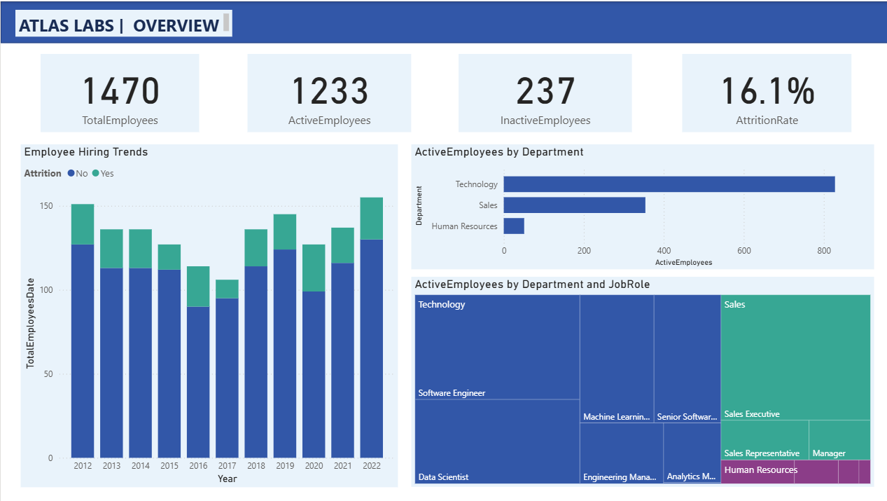
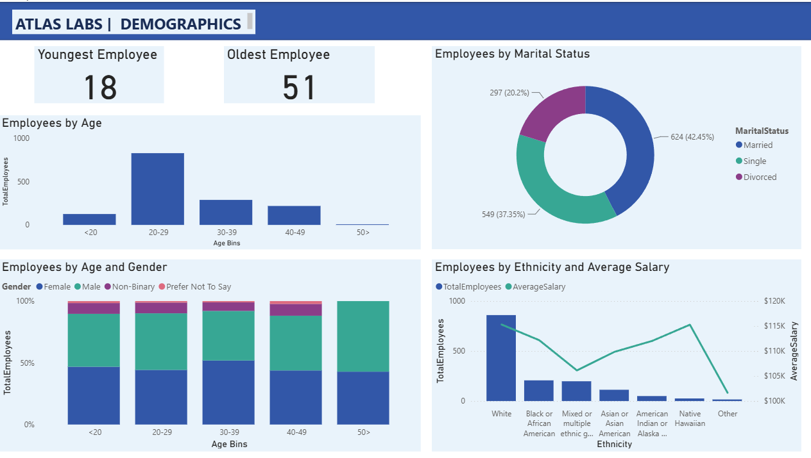
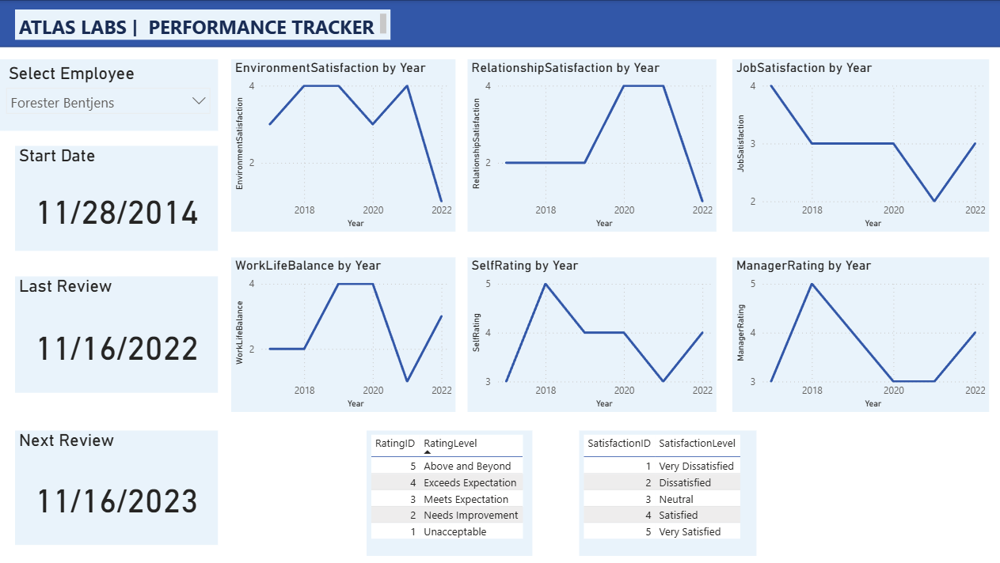
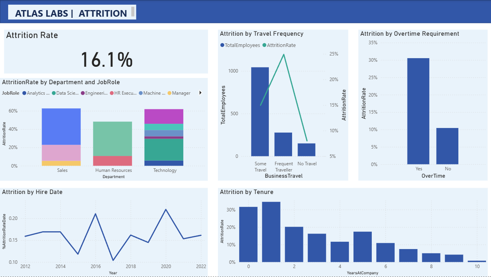

# HR Analytics | Employee Attrition & Workforce Insights

**Power BI | People Analytics | Workforce Performance | Employee Retention**

## Project Overview

Why do employees leave and what can organizations learn from workforce data to improve retention?

This project explores employee attrition, workforce demographics, performance evaluations and satisfaction trends through an interactive Power BI dashboard developed for the fictional organization Atlas Labs.

The objective was to build a reporting solution that helps HR teams understand workforce composition, identify employee groups experiencing higher attrition and make more informed workforce planning decisions.

## Business Objectives

- Monitor workforce headcount, employee attrition and retention patterns.
- Identify differences in attrition across departments and job roles.
- Examine relationships between employee turnover, overtime, business travel and tenure.
- Analyze workforce demographics, compensation and employee satisfaction.
- Provide an interactive reporting tool to support HR decision-making.

## Dashboard Overview

### 1. Workforce Overview
Provides a consolidated view of total employees, active employees, attrition rates and headcount distribution across departments and job roles.

### 2. Employee Demographics
Explores employee composition across age, gender, marital status, ethnicity and salary distributions.

### 3. Performance Tracker
Tracks employee performance evaluations, satisfaction scores, manager ratings and work-life balance indicators.

### 4. Employee Attrition
Analyzes turnover patterns across departments, job roles, overtime, business travel and employee tenure to highlight potential retention concerns.

## Analytical Approach

- Developed four interactive Power BI report pages covering workforce KPIs, demographics, performance and attrition.
- Used DAX measures to calculate and track relevant employee metrics.
- Built visualizations with filters and drill-down capabilities to explore workforce segments.
- Examined relationships between attrition and employee characteristics.
- Organized workforce metrics into a consolidated reporting experience.

## Business Applications

**Employee Retention:** Identify workforce segments with elevated attrition for targeted investigation and potential retention initiatives.

**Workforce Planning:** Monitor headcount distribution and turnover patterns to support resource planning.

**Employee Experience:** Analyze satisfaction, performance and work-life balance trends to inform HR initiatives.

**HR Reporting:** Provide an accessible, centralized view of workforce KPIs for decision-makers.

## Tools & Technologies

Power BI | DAX | Data Modeling | Data Visualization | People Analytics

## Dashboard Previews

### 1. Workforce Overview

### 2. Employee Demographics

### 3. Performance Tracker

### 4. Employee Attrition

  

## Explore the Project

[Download Power BI Report](HR_Analytics_Employee_Attrition.pbix)

*The report can be opened using Power BI Desktop.*

## Author

**Abhijith Penmetcha**

[LinkedIn](https://www.linkedin.com/in/abhijith-penmetcha/)
